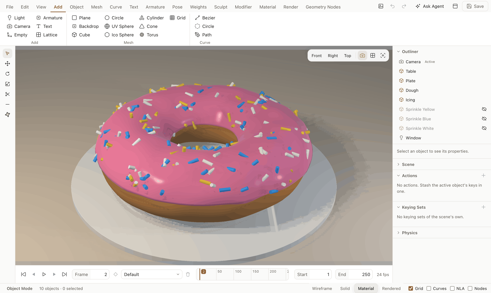
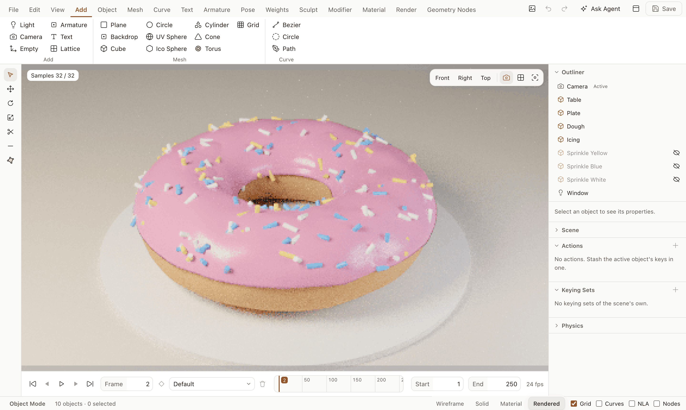
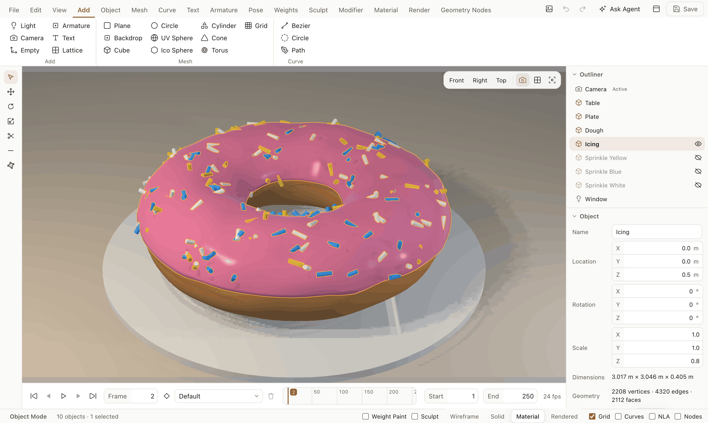
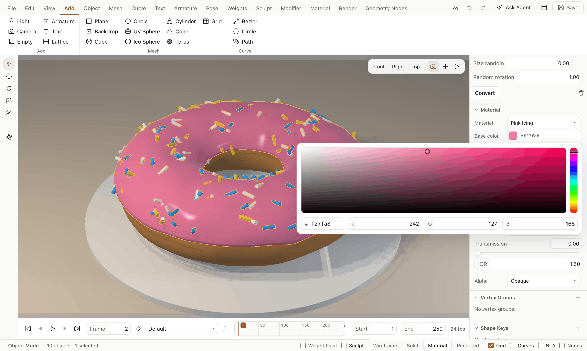
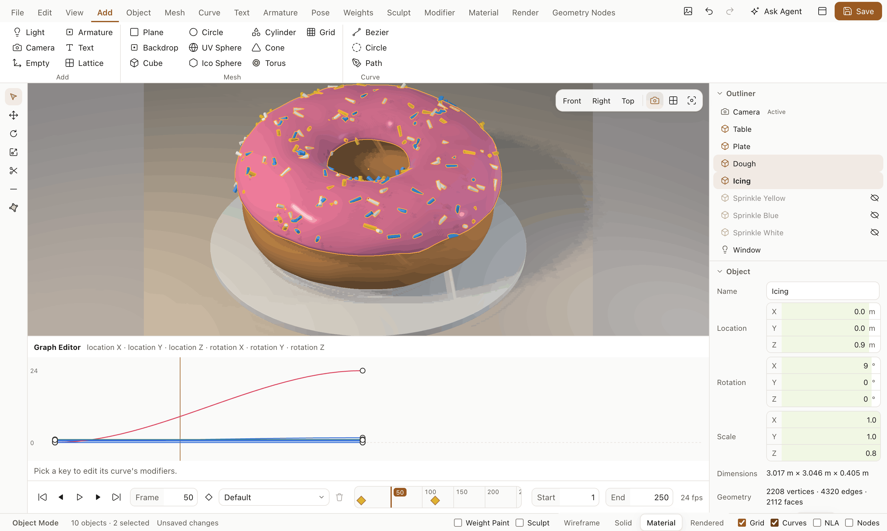
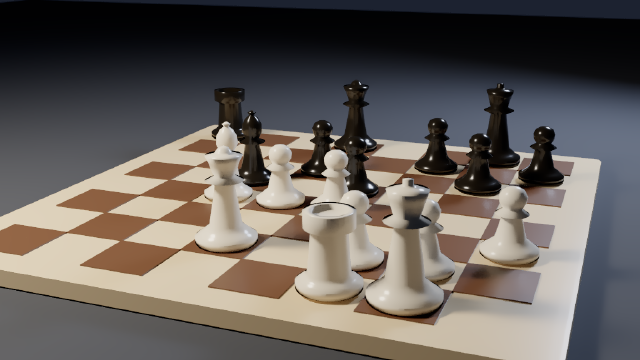
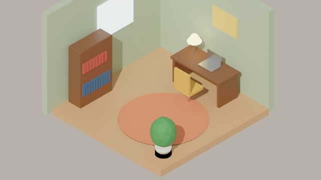
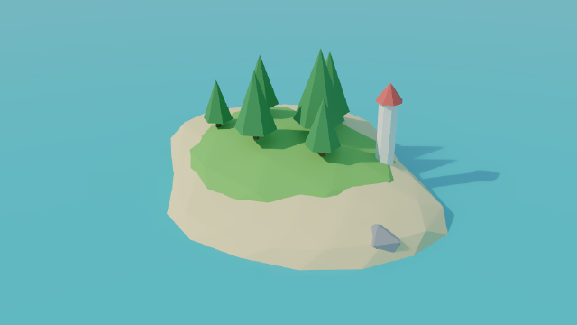

<div align="center">

# Kition Scene

**Kition Scene: a 3D scene editor, for people and AI agents**

Modeling and modifiers · Materials · Rendered viewport · Keyframes · glTF, FBX and USD export · MCP tools for agents

[](LICENSE)
[](https://www.npmjs.com/package/@kition/embed)
[](https://github.com/kitharness/khp)
[](bindings/wasm)

[Use it in Kition](https://kition.ai) · [Embed it](#embed-it-in-your-app) · [Give it to your agent](#give-it-to-your-agent) · [Showcase](https://github.com/KitionAI/kition-showcase/tree/main/scene) · [Developer docs](https://developer.kition.ai) · [KHP](https://github.com/kitharness/khp)

</div>

A 3D scene usually lives in a large file that only the application which made it can open. An AI
agent can look at a render of it, but it can't reach inside. It can't move the light, change a
material, or tell you that an object has slipped out of the shot.

Kition Scene keeps a scene in an open `.kscene` file: objects, meshes, modifiers, materials,
lights, cameras and animation. The editor you work in and the tools an agent calls run the same
Rust engine and the same commands. An agent reads every object, changes what you ask for, checks
the shot, and looks at a preview from the camera. You see the same scene in your viewport.



## What it does

### Why Scene

- **Model with the basics, let modifiers do the rest.** Add cubes, cylinders and spheres; place,
  turn and size them; inset and extrude faces. Stack subdivision, bevel and mirror modifiers and
  change them at any time.
- **Materials you can see as you work.** Make, name and color materials with roughness,
  transmission and index of refraction, and assign them to objects. Material preview shows them in
  the viewport.
- **A viewport that renders.** Switch the viewport to rendered shading and it traces the scene's
  light and shadow, sample by sample.
- **Animate with keyframes.** Key objects on the timeline, and the motion eases between the keys.
  The graph editor shows the curves.
- **Built for agents.** An agent names the objects and the frame it acts on, sees a preview from
  the camera or any view, and fixes what the check reports. Your selection, mode and view stay as
  they were.
- **Open source, in the browser.** Apache-2.0, engine and editor. The engine is Rust, compiled to
  WebAssembly and run in a Web Worker; the viewport draws on the GPU.

### See it

<table>
<tr>
<td width="50%"><br /><b>Rendered shading</b>: the viewport traces light and shadow, sample by sample.</td>
<td width="50%"><br /><b>Outliner and properties</b>: pick an object, then set where it is and how big.</td>
</tr>
<tr>
<td width="50%"><br /><b>Materials</b>: color, roughness, transmission and index of refraction.</td>
<td width="50%"><br /><b>Keyframes</b>: key objects on the timeline and see the motion in the graph editor.</td>
</tr>
</table>

### Made with Scene

<table>
<tr>
<td width="25%"><a href="https://github.com/KitionAI/kition-showcase/tree/main/scene/chess-endgame-study"></a></td>
<td width="25%"><a href="https://github.com/KitionAI/kition-showcase/tree/main/scene/isometric-study-room"></a></td>
<td width="25%"><a href="https://github.com/KitionAI/kition-showcase/tree/main/scene/low-poly-island"></a></td>
<td width="25%"><a href="https://github.com/KitionAI/kition-showcase/tree/main/scene/amber-perfume-bottle"></a></td>
</tr>
</table>

Every sample is built with Scene's own commands. [See all of them](https://github.com/KitionAI/kition-showcase/tree/main/scene).

### Formats

| Opens | Creates | Exports |
| --- | --- | --- |
| `.kscene` | `.kscene` | `.glb`, `.gltf`, `.obj`, `.stl`, `.fbx`, `.usda`, `.usdc`, `.usdz`, `.png` |

Scene also places models into a scene from `.glb`, `.gltf`, `.obj`, `.stl`, `.fbx`, `.usd`,
`.usda`, `.usdc`, `.usdz` and `.blend` files. A `.png` export is a render of the scene. Import and
export are partly there: see [Maturity](#maturity).

## Quick start

### Use it in Kition

Open a `.kscene` file in Kition and it opens in this editor. Kition's agent edits the same file
with the kit's `scene_*` tools. [Download Kition](https://github.com/KitionAI/kition/releases/latest).

### Embed it in your app

Scene's editor is a static package you host yourself, mounted into your page with the Kition SDK's
[`@kition/embed`](https://www.npmjs.com/package/@kition/embed). You keep the files and the users;
the editor reads and writes through the functions you give it.

1. Download `kition-scene-<version>.tgz` from the
   [latest release](https://github.com/KitionAI/kition-scene/releases/latest) and serve its
   `scene-ui/` folder as static files on its own origin, with the headers in the
   [embed reference](https://github.com/KitionAI/kition-sdk/blob/main/docs/platform/reference/embed.md).
2. Install the SDK and mount the editor:

```sh
npm install @kition/embed
```

```ts
import { KitionEmbed } from '@kition/embed'

const editor = await KitionEmbed.mount(document.getElementById('scene')!, {
  kit: { id: 'kit.scene', url: 'https://kits.example.com/scene-ui/' }, // the package you host
  file: { id: 'donut', name: 'Donut.kscene' },
  storage: {
    read: async (id) => api.read(id),                    // { bytes, version }
    write: async (id, bytes, { expectedVersion }) =>     // refuse a stale version
      api.write(id, bytes, expectedVersion),             // { version }
  },
})
```

Every save carries the version it read, so an edit made elsewhere is never written over. The
[embed guide](https://github.com/KitionAI/kition-sdk/blob/main/docs/sdk/embed.md) covers identity,
checks and the rest.

### Give it to your agent

The engine also runs headless, and `kition`, the Kition SDK's command line, serves it as MCP tools
(`scene_inspect`, `scene_run`, `scene_check`, ...) on a folder of scenes, for any MCP client.
Nothing is compiled: you need neither Rust nor the Kition app. Install `kition`, then connect your
agent in the folder:

```sh
curl -fsSL https://github.com/KitionAI/kition-sdk/releases/latest/download/install.sh | sh
# Claude Code, in the folder:
claude mcp add kition -- ~/.kition/bin/kition mcp --workspace "$PWD"
```

On Windows, install it with
`irm https://github.com/KitionAI/kition-sdk/releases/latest/download/install.ps1 | iex`. With
Node.js 20 or later you can skip the install:
`claude mcp add kition -- npx -y @kition/kits-mcp --workspace "$PWD"`.

`kition` holds no kit. The first time the agent opens a `.kscene` file, through the `kit_inspect`
tool the server offers until Scene is installed, `kition` downloads Scene's headless executable into
`~/.kition/kits` and the scene tools appear. `kition kit install scene` downloads it ahead of time,
and `kition kit upgrade` moves it to the newest version. Claude Desktop, Cursor, Codex and the other
commands are in the SDK's
[agent guide](https://github.com/KitionAI/kition-sdk/blob/main/docs/sdk/agent.md#connect-your-agent)
and [`kition` guide](https://github.com/KitionAI/kition-sdk/blob/main/docs/sdk/cli.md). To run a
build of your own (working on the kit itself), see
[docs/development.md](docs/development.md#build-and-check).

A real session on a copy of the donut sample, abridged. The agent turns the pink icing into a
chocolate glaze, checks the scene, and looks at it:

```text
> scene_inspect {"path":"donut.kscene"}
Opened `donut.kscene`: 1024 × 576
{…,"details":{…,"materials":[…,{…,"id":2664431623,…,"name":"Pink Icing",…},…],
  "objects":[{…,"id":4,…,"name":"Camera",…},{…,"name":"Table",…},{…,"name":"Plate",…},
  {…,"name":"Dough",…},{…,"name":"Icing",…},…],…},…,"revision":"kco0",…}

> scene_run {"path":"donut.kscene","basis":"kco0","steps":[{"command":"material.set","params":
    {"material":"Pink Icing","name":"Chocolate Glaze","baseColor":"#5a3420","roughness":0.25}}]}
Ran 1 commands on `donut.kscene` (saved): 1024 × 576 Changes: objects 1 changed.
{"changes":{"changed":[{"edits":[{"after":0.10224174708127975,"before":0.8879231810569763,
  "field":"data.baseColor.0"},…,{"after":"Chocolate Glaze","before":"Pink Icing","field":"name"}],
  …,"id":2664431623,"type":"Material"}],…},…,"revision":"kco1","saved":true}

> scene_check {"path":"donut.kscene","basis":"kco1"}
Checked `donut.kscene`: the kit found nothing wrong.

> scene_inspect {"path":"donut.kscene","preview":true}
Preview of `donut.kscene` from Scene.
{…,"preview":{"columns":2,"frames":[{"camera":4,"frame":1,"label":"camera",…},{…,"label":"front",…},
  {…,"label":"right",…},{…,"label":"top",…}],…,"mimeType":"image/png","rows":2,…},…}
[image image/png]
```

Every write names the revision it read (`basis`), and its answer lists each change with the value
before and after. The check also finds zero scales, inside-out meshes, a missing camera or light,
and objects outside the shot. The agent's guide is [agent/guide.md](agent/guide.md).

## Maturity

Preview: early, expect gaps. Version 0.1.0 · KHP 1.0, conformance level `basic`.

| Works today | Partly there | Not yet |
| --- | --- | --- |
| Adding, placing, turning and sizing objects | Importing and exporting other 3D formats | Motion blur and compositing in the viewport (they are in final renders) |
| Inset and extrude; subdivision, bevel and mirror modifiers | Drivers, actions, the NLA and keying sets | Automatic UV seams in the viewport |
| Materials, and rendered shading in the viewport | Rigid bodies, cloth and soft bodies | Color looks beyond Standard and AgX: no white balance or curves |
| Keyframes on the timeline | Sculpting and weight painting | Boids on the ground, with collisions |

"Partly there" means the engine has the commands, but no test yet shows them working end to end
in the editor and surviving save and reopen.

Known gaps: [docs/gaps.md](docs/gaps.md). What's next: [docs/roadmap.md](docs/roadmap.md).

## Build and contribute

Build and test instructions are in [docs/development.md](docs/development.md). Read
[CONTRIBUTING.md](.github/CONTRIBUTING.md) before opening a pull request, and ask questions in
[Discussions](https://github.com/KitionAI/kition/discussions) or on [Discord](https://discord.gg/bFSjRDjVY).

## License

Apache-2.0 ([LICENSE](LICENSE)). Third-party licenses and notices are listed in [NOTICE](NOTICE).
